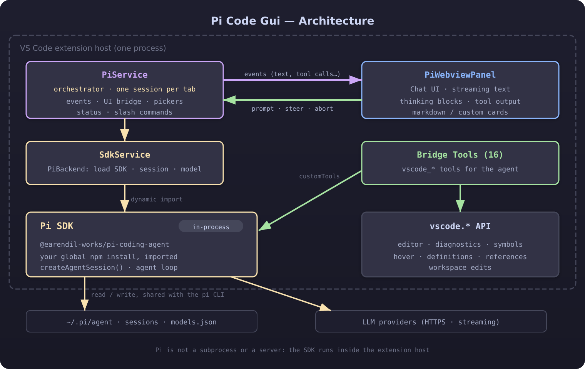

# Pi Code Gui

[](https://marketplace.visualstudio.com/items?itemName=NimbleTron.pi-code-gui)
[](https://marketplace.visualstudio.com/items?itemName=NimbleTron.pi-code-gui)
[](https://marketplace.visualstudio.com/items?itemName=NimbleTron.pi-code-gui)
[](https://open-vsx.org/extension/NimbleTron/pi-code-gui)
[](https://open-vsx.org/extension/NimbleTron/pi-code-gui)
[](https://github.com/NimbleTronAI/pi-code-gui/actions/workflows/publish.yml)
[](LICENSE)
[](https://pi.dev)

> A native VS Code editor experience for the [**Pi coding agent**](https://pi.dev) — Pi runs inside VS Code, not in a terminal, with full access to your editor state, diagnostics, and symbols.

<p align="center">
  
</p>

> **Using Rust Pi?** Support for it ended with version 0.2.3 — see [what that means and how to keep using it](#rust-pi-support-has-ended).

## Quick Start

1. **Install Pi**: On first launch, Pi Code Gui checks for Pi and offers to install it if it's missing. To install it yourself: `npm install -g @earendil-works/pi-coding-agent` (needs Node.js + npm).
2. **Set an API key**: Run **PiGui: Set Up API Key / Login** from the command palette (`Ctrl+Shift+P`), or set `ANTHROPIC_API_KEY` / `OPENAI_API_KEY` (or `DEEPSEEK_API_KEY`, etc.) in your environment.
3. **Open the chat**: Click the Pi icon in the activity bar, or run **PiGui: Code Agent** from the command palette.
4. **Start prompting**: The agent reads files, runs commands, makes edits, and inspects your editor state, diagnostics, and symbols through the VS Code bridge.

## Why Pi Code Gui?

The Pi coding agent is a powerful AI pair programmer, with an exceptional terminal (TUI) implementation.

For people who prefer a GUI experience, this extension embeds Pi directly in VS Code's native UI:

- **In-editor chat** — streaming responses, thinking blocks, and tool execution results rendered in a webview panel, not a terminal buffer.
- **Native VS Code bridge** — 16 tools that call VS Code APIs directly: inspect the active editor, check diagnostics, find symbols, look up types, apply edits, and format code.
- **Session persistence** — conversation history survives VS Code restarts.
- **Multi-session support** — multiple chat panels, each with an independent model and thinking level.

## Features

| Feature | Description |
|---------|-------------|
| 💬 **Chat panel** | Streaming text, collapsible thinking blocks, tool call/result rendering, markdown with syntax-highlighted code blocks |
| 🧰 **Editor bridge** | Agent reads open editors, checks diagnostics, inspects symbols/types, applies edits, formats code through VS Code APIs |
| 🔄 **Session history** | Auto-saved conversations can be resumed or deleted. Find with text search |
| 🪟 **Multi-session** | Multiple independent chat panels, each with its own model, thinking level, and conversation tree |
| 🔐 **Flexible auth** | Runtime API key overrides via VS Code settings, env vars, or the built-in auth config |
| 🔧 **Settings** | Toggle auto-compaction, auto-retry, skills, context-file, and prompt-template loading — all from the UI |
| 📋 **Custom Messages** | Extensions can render inline interactive cards with buttons, clickable rows, and live polling updates — see [§ Custom Messages](#custom-messages--minimal-working-example) |
| 🛠️ **Tool control** | `/tools` command opens a grouped checkbox picker to select which built-in, bridge, or extension tools are active per session. Persisted to session file, restored on resume |
| 📦 **Packages** | The Packages view manages your Pi packages — each marked **active** (loaded) or **available** (installed but not loaded), with provenance/safety signals |

## Gotchas

- **⚠️ Cost & token figures are estimates, not your bill.** The token counts and dollar amounts in the status bar are computed locally — from the model catalog's per-model rates and the usage Pi reports back — purely for at-a-glance guidance. They can be wrong or incomplete: published rates change, the catalog can lag a provider's current pricing, and providers meter in ways a flat rate doesn't capture (cache reads/writes, request minimums, batch/volume discounts, taxes). Some providers report no usage for a turn, in which case the figure stays `0`; where we have no rate for a model we show `$??` rather than a misleading `$0`. Hover the cost to see whether it is an estimate or, for providers that report it (OpenRouter), the billed amount. **Always rely on your provider account's usage/billing dashboard for actual cost — never on these in-app summaries.**
- **DeepSeek sessions show `$??` instead of a cost.** DeepSeek's price changes with the time of
  day, the bundled price catalog can hold only one price per model, and DeepSeek's API doesn't
  report what it billed. So we can't compute a figure we would trust, and we show none rather
  than a wrong one. Hover the `$??` for details. Token counts and context % are unaffected, and the same models reached through a
  gateway (OpenRouter, Vercel AI Gateway) still price normally. Tracked upstream as
  [pi#8510](https://github.com/earendil-works/pi/issues/8510) and
  [pi#8491](https://github.com/earendil-works/pi/issues/8491).
- Not all TUI behaviours map well into VSCode's UX. For instance, having new UI widgets spawned by extension packages. We did a best-effort implementation, but there is definitely room for improvement.

## Custom Messages — Minimal Working Example

Custom messages render inline in the conversation stream with interactive
elements (buttons, clickable rows, status indicators). This is the
webview equivalent of Pi's TUI `MessageRenderer`.

### 1. Register a renderer (Pi Code GUI extension host)

Pi extensions call `globalThis.__piRegisterMessageRenderer(customType, sourceCode)`.
The second argument is **JavaScript source code as a string** — it runs in the
webview DOM and receives `(data, containerEl, escapeHtml)`.

```typescript
// In your Pi extension's entry point (e.g. index.ts):

export default function (pi: ExtensionAPI) {
  // Register renderer at load time. Defer to session_start if the
  // hook may not be available at file evaluation time.
  function registerRenderer() {
    const reg = (globalThis as any).__piRegisterMessageRenderer;
    if (typeof reg !== "function") return;

    reg("my-extension", `
// This code runs in the webview DOM. Variables declared here are scoped
// to this renderer invocation and won't leak to other cards or the global
// scope (Pi Code GUI wraps renderers in an IIFE or <script> tag).

// data: the full custom message payload from pi.sendMessage()
var items = (data.details && data.details.items) || [];
if (!items.length) {
  containerEl.innerHTML = "<p>No items.</p>";
  return;
}

var h = '<div class="my-card">';
for (var i = 0; i < items.length; i++) {
  var it = items[i];
  // escapeHtml() is provided by Pi Code GUI — use it for any
  // user-supplied text to prevent XSS.
  h += '<div class="my-item"' +
    // data-command attributes automatically execute the slash command
    // when clicked. The leading / is added by the framework — omit it.
    ' data-command="my_action ' + escapeHtml(it.id) + '"' +
    ' style="display:block;border:1px solid var(--vscode-panel-border,#333);margin:4px 0;padding:6px;border-radius:4px;cursor:pointer">';
  h += '<strong>' + escapeHtml(it.label) + '</strong>';
  h += ' <span style="color:#888">' + escapeHtml(it.status) + '</span>';
  h += ' <button data-command="my_approve ' + escapeHtml(it.id) + '"' +
    ' style="margin-left:8px">Approve</button>';
  h += '</div>';
}
h += '</div>';
containerEl.innerHTML = h;
`);
  }

  // Try immediately (hook may already exist), and on session_start.
  registerRenderer();
  pi.on("session_start", () => registerRenderer());
}
```

### 2. Send the message (anywhere in your Pi extension)

```typescript
// From a slash command, tool, or event handler:

pi.sendMessage({
  customType: "my-extension",   // must match the registered customType
  display: true,                // true = inline card, false/undefined = notification
  content: "Fallback markdown if no renderer registered",  // graceful fallback
  details: {                    // passed to your renderer as data.details
    items: [
      { id: "abc123", label: "Fix login bug",      status: "awaiting" },
      { id: "def456", label: "Add dark mode toggle", status: "in-progress" },
    ]
  }
}, { triggerTurn: false });     // false = don't wake the LLM
```

When the message arrives in the webview:
- **If a renderer is registered for `my-extension`:** the renderer runs,
  `containerEl` is populated with your HTML, and the card appears inline.
- **If no renderer is registered:** the `content` string is rendered as
  markdown inside a bordered card (graceful fallback).

### 3. Action buttons

Buttons with `data-command` attributes automatically execute the slash
command when clicked. Pi Code GUI prepends `/` — so `data-command="my_action abc"`
becomes the slash command `/my_action abc`.

```html
<button data-command="my_attach abc123">Attach</button>
<button data-command="my_approve abc123">Approve</button>
```

Clickable rows: put `data-command` on any element, not just `<button>`:

```html
<div data-command="nimble_attach abc123" style="cursor:pointer">
  Click this entire row
</div>
```

### 4. Polling / live updates

To refresh a card with new data, call `pi.sendMessage()` again with the
**same `customType`** and updated `details`. The webview finds the existing
card and re-runs the renderer in-place:

```typescript
setInterval(async () => {
  const items = await fetchWorkItems();
  pi.sendMessage({
    customType: "my-extension",
    display: true,
    content: "Items updated",
    details: { items }
  }, { triggerTurn: false });
}, 5000);
```

**Unique cards:** If you want each invocation to create a *new* card
(instead of replacing the old one), use a unique `customType` per
invocation (e.g. `my-extension-1`, `my-extension-2`). Register a renderer
for each unique type.

### 5. Complete file structure (Pi extension directory)

```
.pi/extensions/my-extension/
  index.ts          # Pi extension entry point (registration + sending)
  renderer.js       # (optional) Renderer logic in a separate file
```

**Using a separate renderer file:** Instead of embedding the renderer as
a string literal, read it from disk at load time:

```typescript
import { readFileSync } from "node:fs";
import { join } from "node:path";

const src = readFileSync(join(__dirname, "renderer.js"), "utf-8");
reg("my-extension", src);
```

This avoids TypeScript string-escaping issues and lets you test the
renderer independently in a browser console.

## Architecture

- **PiService** manages the agent lifecycle. It loads the `@earendil-works/pi-coding-agent` SDK **in-process** from your global npm install (so `pi update --self` picks up new SDK versions without an extension update), subscribes to agent events, translates them into chat UI messages, and handles model/thinking/settings changes.
- **PiWebviewPanel** renders a webview chat UI. It subscribes to PiService events and re-renders streaming text, thinking blocks, tool execution, bash output, compaction summaries, and custom messages in real time.
- **Bridge tools** are registered as SDK `customTools` constructed with `defineTool()` and Typebox schemas, the same way the SDK's own built-in tools are defined.

<!--
  This image is a PNG because vsce forbids inline SVGs in the README. The PNG is
  GENERATED from media/architecture.svg (the source of truth) — do NOT hand-edit it.
  After changing the SVG: run `npm run gen:diagram`, then commit both files. The
  `package`/`vsix` build runs `check:diagram` and FAILS if the two drift apart.
-->


## Extension Settings

| Setting | Type | Default | Description |
|---------|------|---------|-------------|
| `pi-code-gui.promptToInstall` | boolean | `true` | Prompt to install Pi if not found |
| `pi-code-gui.autoOpenOnStart` | boolean | `true` | Open a Pi tab automatically when the window starts |
| `pi-code-gui.panelLocation` | string | `beside` | Where a chat opens: `beside` (split off a second group) or `active` (a tab in the current group) |
| `pi-code-gui.systemPromptAppend` | string | `""` | Additional instructions appended to the system prompt |
| `pi-code-gui.enableSkills` | boolean | `true` | Load project and global pi skills |
| `pi-code-gui.enableContextFiles` | boolean | `true` | Inject project context files |
| `pi-code-gui.enablePromptTemplates` | boolean | `true` | Register custom slash commands |
| `pi-code-gui.defaultModelProvider` | string | `""` | Default model provider (e.g. `anthropic`). Empty = auto-detect |
| `pi-code-gui.defaultModelId` | string | `""` | Default model ID (e.g. `claude-sonnet-4-5`). Requires provider set |
| `pi-code-gui.defaultThinkingLevel` | string | `"off"` | Default thinking level for new sessions |
| `pi-code-gui.contextBudget` | number | `0` | Per-session token budget (0 = model default). Drives auto-compaction |
| `pi-code-gui.sessionDir` | string | `""` | Custom directory for session `.jsonl` files. Empty = pi SDK default (`~/.pi/agent/sessions/`) |

## Requirements

- VS Code 1.125+
- **Pi** — `@earendil-works/pi-coding-agent`, installed globally (needs Node.js + npm). The extension offers to install it if it's missing.
- At least one API key (Anthropic, OpenAI, DeepSeek, Gemini, etc.) — run **PiGui: Set Up API Key / Login** or see the [Pi quickstart](https://pi.dev/docs/latest/quickstart)

## Development

```bash
pnpm install          # Install dev dependencies
pnpm run compile      # Type-check, lint, and build with esbuild
pnpm run watch        # Watch mode for development
```

Press `F5` in VS Code to launch the Extension Development Host.

To package a `.vsix`:

```bash
pnpm run vsix         # Creates pi-code-gui-x.x.x.vsix
```

## Rust Pi support has ended

**Version 0.2.3 is the last release of Pi Code Gui that supports Rust Pi** ([`pi_agent_rust`](https://github.com/Dicklesworthstone/pi_agent_rust)). From 0.2.8 on, the extension runs on Pi alone, and Rust sessions, the plan-mode and approval strip, and all `rust*` settings are gone.

**Why.** Pi Code Gui could offer Rust Pi as a second engine because it was built as a drop-in replacement for Pi: the same sessions, the same model catalog, the same behaviour, so one interface could drive both. That is no longer its direction. Rust Pi's own [product direction](https://github.com/Dicklesworthstone/pi_agent_rust#current-product-direction) now says it *"is no longer trying to be a strict drop-in replacement for the legacy TypeScript Pi"*, takes a different project as its reference, and *"may intentionally differ"* from Pi. That is a sound choice for Rust Pi — but it means every release would move the two engines further apart, and this extension would keep falling behind both of them. We would rather do one engine well than two badly.

**We're sorry.** If you chose this extension for Rust Pi — for its speed, its plan mode, or its approval controls — this takes something away from you, and that's on us, not on the Rust Pi project. Thank you for using it, and for the issues and feedback that shaped it.

### If you want to keep using Rust Pi in VS Code

Pick whichever suits you:

1. **Stay on 0.2.3.** In the Extensions view, open Pi Code Gui → the gear menu → **Install Specific Version…** → **0.2.3**. Then, in the same menu, turn off **Auto Update** for this extension, so it stays there. Version 0.2.3 was tested against Rust Pi **0.3.0**; newer Rust Pi releases may not work with it.

2. **Fork 0.2.3 and carry it forward.** The extension is MIT-licensed, and the release is tagged:

   ```bash
   git clone https://github.com/NimbleTronAI/pi-code-gui.git
   cd pi-code-gui
   git checkout v0.2.3
   corepack enable && pnpm install --frozen-lockfile
   pnpm run vsix                                   # needs ripgrep (rg) on your PATH
   code --install-extension pi-code-gui-0.2.3.vsix
   ```

   If you publish your fork, give it **your own `name` and `publisher`** in `package.json`, so it doesn't collide with or pass for this extension, and keep the MIT `LICENSE`.

   **Please read this before working on a fork.** Rust Pi and its runtime dependencies (`asupersync`, `franken-*`) ship under an MIT license **with an OpenAI/Anthropic rider**: their source and derivatives may not be made available to those parties. So **don't read or paste Rust Pi's source into AI coding assistants** (Claude Code, Copilot, Cursor, …), and don't port its code. Work black-box, as this extension did: drive the released *binary* over `pi --mode rpc`, and use its `--help` output, observed behaviour, and its issue tracker as references. Your `v0.2.3` checkout includes `scripts/check-cleanroom.sh`, which enforces this at commit time — if it fails, fix the reference rather than bypassing it. The full rule is in that checkout's `AGENTS.md`, §"pi clean-room — license law".

3. **Use Rust Pi directly**, in its own terminal interface — see its [README](https://github.com/Dicklesworthstone/pi_agent_rust).

### Cleaning up after Rust Pi

Upgrading removes nothing from your disk except the model entries described below. Three things you may want to tidy:

- **Your Rust sessions** are still in `~/.pi/agent/sessions-rust/`. 0.2.8 no longer lists them, but they are untouched and remain readable by Rust Pi itself — and by 0.2.3, if you go back.
- **Model entries this extension wrote for Rust are removed for you.** Rust sessions added entries to `~/.pi/agent/models.json`, each marked `"_managedBy": "pi-code-gui@…"`. That file is shared with Pi and the `pi` CLI, and those entries replace Pi's own definitions of the same models — which can cap long outputs and drop thinking-level settings. Each time the extension starts, it removes any marked entries it finds. If you edited one, we keep it whole, since it is yours now. Older releases also filled in a provider's `api` and `baseUrl` without a marker; we remove those too, but only when it is a connection we shipped for that provider and every model listed under it is one of our unedited entries. Your own settings on that provider, such as an API key, stay. A provider our removal leaves empty is removed as well. Nothing else in the file changes, though we rewrite it with two-space indentation. If the file isn't plain JSON (comments or trailing commas, say), we leave it untouched and write the reason to the Pi Code Gui output log. If you go back to 0.2.3, it writes them again.
- **The Rust Pi binary, if you let the extension install it for you,** stays in VS Code's extension storage, in a `rust-pi` folder under `<globalStorage>/nimbletron.pi-code-gui/`. That is `~/.config/Code/User/globalStorage/` on Linux, `~/Library/Application Support/Code/User/globalStorage/` on macOS and `%APPDATA%\Code\User\globalStorage\` on Windows (other VS Code builds use their own folder name in place of `Code`). You can delete the `rust-pi` folder. We don't touch it.

## Credits

Pi Code Gui is a GUI shell around [**Pi**](https://pi.dev) — [`@earendil-works/pi-coding-agent`](https://www.npmjs.com/package/@earendil-works/pi-coding-agent) by the [earendil-works](https://github.com/earendil-works/pi) team. All the hard agent work lives there; this extension embeds its SDK in-process.

Through version 0.2.3 the extension also supported [**Rust Pi**](https://github.com/Dicklesworthstone/pi_agent_rust) — [`pi_agent_rust`](https://github.com/Dicklesworthstone/pi_agent_rust) by [Jeffrey Emanuel (Dicklesworthstone)](https://github.com/Dicklesworthstone), a high-performance, zero-`unsafe` Rust port. Thank you for it, and for the release notes and issue answers that made integrating it possible.

Project names and trademarks belong to their respective owners.

## License

MIT — see [LICENSE](LICENSE) for details.
